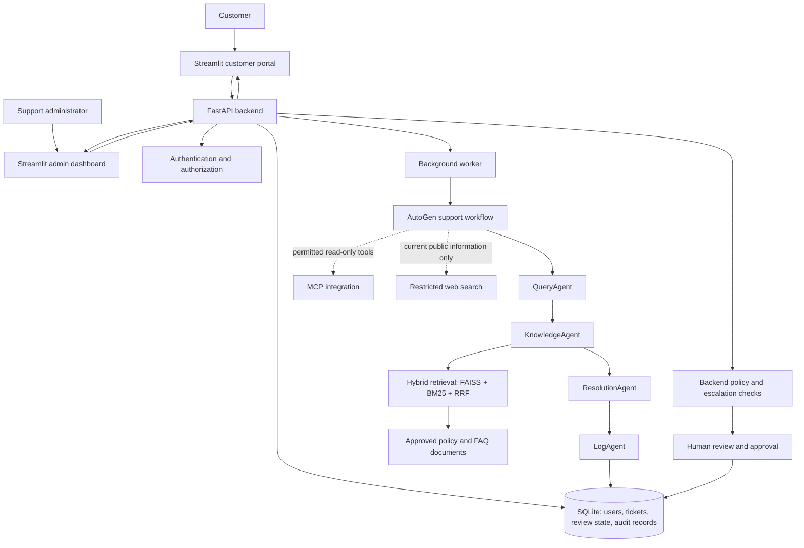
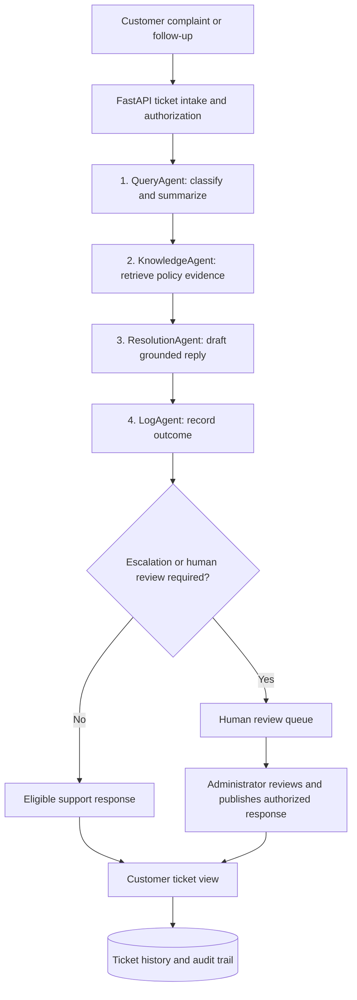

# FixFlow AI — NovaCart Multi-Agent Customer Support

FixFlow AI is a local-first customer-support application built with a **FastAPI backend**, **Streamlit frontend**, **AutoGen multi-agent workflow**, and **hybrid retrieval-augmented generation (RAG)**. It helps process customer complaints, retrieve policy evidence, draft grounded responses, and route sensitive cases to human administrators.

> Local validation has passed the reported regression and targeted demo gates. This does **not** certify production security, live payment processing, or readiness to handle real customer data.

## Features

- Customer registration, verification, sign-in, ticket submission, and ticket follow-ups.
- Customer-specific ticket access and administrative review workflows.
- Four-agent AutoGen support workflow for query handling, knowledge retrieval, resolution, and outcome logging.
- Hybrid **FAISS + BM25** retrieval combined with **Reciprocal Rank Fusion (RRF)** and evidence/citation controls.
- Read-only MCP integration and restricted public web research for appropriate current-information questions.
- SQLite-backed tickets, audit records, AI results, and durable refund-review decisions.
- Worker leases, heartbeats, retry/recovery handling, stale-result protection, and idempotent processing safeguards.
- Administrative queue, draft review/publishing, audit inspection, and CSV export.

## Safety and refund rules

- **Refund requests of ₹500 or more, including exactly ₹500, require backend-enforced human review.** This includes refund requests introduced in follow-up messages.
- Fraud, legal, and payment-dispute concerns are escalated independently of the amount.
- The application **does not execute real refunds or payment transactions**.
- AI answers should be grounded in approved evidence and must not invent order status, refund status, payment outcomes, or delivery estimates.
- Internal-only policy material must not be disclosed to customers; customer records must remain isolated by account.
- Public web search must not disclose private customer information.

## System architecture

FixFlow AI separates the customer-facing interface, authenticated API, background processing, and evidence-backed AI workflow. The diagram below is a conceptual map of the documented components; it is not a claim that every integration is invoked for every ticket.



### Four-agent workflow

The AutoGen team is organized around four distinct responsibilities:

| Agent | Responsibility | Typical output |
| --- | --- | --- |
| **QueryAgent** | Understand the complaint and classify category, urgency, and sentiment. | Structured issue summary and classification |
| **KnowledgeAgent** | Retrieve relevant passages from approved documents using hybrid RAG and preserve source references. | Evidence passages and citations |
| **ResolutionAgent** | Draft a customer-facing response grounded in the retrieved evidence; avoid inventing policies or transaction outcomes. | Evidence-backed response draft |
| **LogAgent** | Record the ticket outcome and support the escalation/audit workflow. | Logged result and escalation information |



**Important:** The flowchart shows the logical support process, not a guarantee that the AI can approve or execute financial transactions. Backend checks and human review are authoritative. Refund requests of **₹500 or more** (including ₹500), fraud/legal/payment disputes, missing order verification, and missing required evidence must be handled under the applicable safeguards. **No refund is automatically executed.**

### Hybrid RAG and supporting services

- **FAISS** supplies vector-similarity retrieval; **BM25** supplies lexical retrieval; **Reciprocal Rank Fusion (RRF)** combines their ranked results.
- Retrieved policy/FAQ passages support citations and grounding checks; insufficient evidence must not become an invented policy answer.
- **MCP** is described as read-only, and public web search is restricted to appropriate current-information needs. Neither should expose private customer records.
- **SQLite** stores ticket and review state, while the separate worker handles AI processing and recovery. The admin interface supports review, publication, and audit inspection.
- The **frontend, API, and worker run as separate local processes**. Do not use the isolated test database for normal application work.

## Local setup — Windows CMD

Requirements: a compatible Python environment, dependencies from `requirements.txt`, and the configured local environment variables. Use the project's existing virtual environment if it is already working; do not recreate it unnecessarily.

```cmd
cd C:\Users\Admin\Desktop\nexora\fixflow-ai
venv\Scripts\activate

pip install -r backend/requirements.txt
pip install -r frontend/requirements.txt

```

Keep API keys and credentials in local environment configuration. **Never commit `.env`, SQLite databases, local mailbox contents, or credentials.** Refer to the project's environment template when available; do not copy real values into documentation.

### Start the API

In terminal 1:

```cmd
cd C:\Users\Admin\Desktop\nexora\fixflow-ai
venv\Scripts\activate
python -m uvicorn backend.main:app --host 127.0.0.1 --port 8000
```

### Start the frontend

The Streamlit entry point is **`frontend/app.py`**. A root-level `app.py` is **not** an architectural defect. From the repository root, use the tested project-relative command below; when inside `frontend/`, the equivalent entry-point form is `streamlit run app.py` (subject to the same environment and import configuration). No wrapper file is required.

In terminal 2:

```cmd
cd C:\Users\Admin\Desktop\nexora\fixflow-ai
venv\Scripts\activate
set FIXFLOW_API_URL=http://127.0.0.1:8000
python -m streamlit run frontend/app.py --server.address 127.0.0.1 --server.port 8501
```

Open **http://127.0.0.1:8501**.

### Start the background worker

In terminal 3, activate the same virtual environment and ensure the required model, retrieval, and integration settings are available:

```cmd
cd C:\Users\Admin\Desktop\nexora\fixflow-ai
venv\Scripts\activate
python -m backend.worker.main
```

For a fresh installation, build the policy index using the project's existing configured ingestion procedure before expecting RAG answers. Do not rebuild or overwrite an already validated local index unnecessarily.

## Local test validation

The following results were reported from the earlier RC1 local validation cycle (historical, not the latest full suite):

| Validation | Result |
| --- | --- |
| Final non-browser regression | **247 passed, 4 warnings, 0 failures** (76.44 s) |
| Browser end-to-end tests | **8 passed** (earlier validated run) |
| Lease-hardening targeted tests | **12 passed** |
| Final security-gate tests | **6 passed** |
| Live AI/RAG, MCP, and Serper integration checks | Previously exercised successfully in targeted runs |

The test counts **overlap** and should not be added together. The four warnings in the final regression were deprecation warnings.

To rerun the final non-browser suite from the project root:

```cmd
python -m pytest -q -rs -rw -p no:playwright --ignore=tests/e2e/test_portal_ui.py --ignore=tests/e2e/test_customer_complaint_journey.py
```

For isolated browser E2E runs, use the separate test services and database (API port **8001**, UI port **8502**, database `fixflow_e2e_test.sqlite3`) rather than the normal local app. Set the corresponding test URLs before running browser tests.

### Latest reported full regression (2026-11-03 handoff)

The latest full-suite result supplied in the project conversation is **581 passed, 14 skipped, 4 warnings, 0 failures**. This supersedes the older 247-pass snapshot for the overall regression status; individual targeted runs below remain useful historical evidence. The excluded browser portal E2E test is not claimed as passing in this result. These figures are reported results, not tests rerun by this README update.

## RC1 validation scope

The final security-gate checks covered:

1. **Cross-customer isolation:** unauthorized customers cannot access another customer's ticket data.
2. **Refund follow-up enforcement:** refund requests at the ₹500 boundary are routed for human approval, including follow-ups.
3. **Process-restart durability:** persisted review state and worker recovery were exercised across separate Python processes.

### Latest local test log (reported 2026-11-02)

- `python scripts/run_local_validation.py --e2e`: **327 backend/offline passed** and **8 browser E2E passed**; deprecation warnings only.
- `python -m pytest -q tests/test_phase10_consolidated.py --tb=short`: **7 passed**, after `FIXFLOW_LOCAL_DEMO=0` was set in the command session.
- `python -m pytest -q tests/test_resolved_evidence_upload.py --tb=short`: **1 passed**.
- The test sets may overlap; these are user-supplied Windows logs, not tests rerun in this documentation update.

### Six mandatory demo cases

| Scenario | Reported outcome | Evidence |
| --- | --- | --- |
| Late delivery | ANSWERED, 2 citations | `tests/test_buildathon_live_six_scenarios.py` |
| Refund-policy request | ANSWERED, 3 citations | same |
| Forgotten password | ANSWERED, 1 citation | same |
| Broken blender | ANSWERED, 1 citation | same |
| Triple charge / legal threat | ESCALATED | same |
| Unsupported custom gift cards | ESCALATED, no citations | same |

These reported outcomes describe the support response; **ANSWERED is not proof that a refund or replacement transaction occurred**. No real payment execution is implemented.

### Two additional safety cases

1. **Refund without verified order ID:** the app must request verification or human review, and never execute a refund.
2. **Damaged product without required photo evidence:** the app must request evidence or route to human review; never execute a refund.

Use the screenshot inventory below for the available captures. The automated test outcomes and screenshots are distinct evidence; do not treat an image as proof of a scenario it does not visibly demonstrate.

### Four-Agent Workflow Verification

The following targeted tests passed:

| Test | Result |
|---|---|
| Live four-agent workflow with synthetic policy evidence | PASS |
| Agent events are observed, not generated | PASS |

These tests provide evidence of workflow integration and authentic
agent-event recording.

See `evidence/screenshots/` for the canonical screenshot inventory. Add any verified terminal test captures there rather than maintaining a second root-level screenshot directory.

## Submission screenshot gallery

Keep **one canonical screenshot directory**: `evidence/screenshots/`. The names below are transcribed from the screenshot-folder view shared in this conversation. Links assume `.png` extensions (verified for some files in the available project copy); confirm the exact filenames and extensions on your machine before committing. Images are evidence of the visible UI only, not independent proof of backend safety.

| Area | Screenshot | What it illustrates |
| --- | --- | --- |
| Authentication and onboarding | [Registration customer.png](evidence/screenshots/Registration%20customer.png) | Customer registration |
| Authentication and onboarding | [Verify Email.png](evidence/screenshots/Verify%20Email.png) | Email verification |
| Customer portal | [Dashboard_Customer.png](evidence/screenshots/Dashboard_Customer.png) | Customer dashboard |
| Customer portal | [My Tickets Section.png](evidence/screenshots/My%20Tickets%20Section.png) | My tickets |
| Ticket lifecycle | [Ticket raised.png](evidence/screenshots/Ticket%20raised.png) | Ticket submission confirmation |
| Customer support | [Helpcentre query.png](evidence/screenshots/Helpcentre%20query.png) | Help-centre query |
| Returns and policies | [ReturnTicket.png](evidence/screenshots/ReturnTicket.png) | Return ticket |
| Returns and policies | [ReturnWindow.png](evidence/screenshots/ReturnWindow.png) | Return-window policy answer |
| Returns and policies | [fashionproduct_returnWindow.png](evidence/screenshots/fashionproduct_returnWindow.png) | Fashion return-window answer |
| Grounded RAG | [policyreferences.png](evidence/screenshots/policyreferences.png) | Policy references and citations |
| Customer support | [replacementquery.png](evidence/screenshots/replacementquery.png) | Replacement query |
| Safety and escalation | [damaged Product_humanreview.png](evidence/screenshots/damaged%20Product_humanreview.png) | Damaged-product review case |
| Safety and escalation | [WithoutEvidence Claim.png](evidence/screenshots/WithoutEvidence%20Claim.png) | Claim without supporting evidence |
| Admin review | [Human Review.png](evidence/screenshots/Human%20Review.png) | Human-review screen |
| Admin review | [humanReview.png](evidence/screenshots/humanReview.png) | Human-review details |
| Admin review | [Resolve Option after reply.png](evidence/screenshots/Resolve%20Option%20after%20reply.png) | Admin resolution option |
| Ticket lifecycle | [Resolved Ticket.png](evidence/screenshots/Resolved%20Ticket.png) | Resolved ticket |
| Auditability | [Audit Log.png](evidence/screenshots/Audit%20Log.png) | Audit log |
| Section 7 logging | [CSV File.png](evidence/screenshots/CSV%20File.png) | CSV complaint log |
| Section 7 logging | [Download CSV.png](evidence/screenshots/Download%20CSV.png) | CSV export |
| Validation reference | [SixTestcasesMentioned in Statement.png](evidence/screenshots/SixTestcasesMentioned%20in%20Statement.png) | Six required demo cases reference |

### Recommended evidence walkthrough

The README links above allow a reviewer to follow registration and verification, customer dashboard, ticket creation, grounded policy answers, human review, ticket resolution, audit logs, and CSV export. The **six mandatory test scenarios** are documented separately in the test table; the screenshot labeled `SixTestcasesMentioned in Statement` is a reference image, not six individual execution screenshots.

For human-review cases, screenshots do **not** imply a refund or replacement was executed. The application deliberately does not execute real financial transactions.

### Screenshot folder and Git hygiene

- Do not maintain a second root-level `screenshots/` folder. Consolidate confirmed submission images into `evidence/screenshots/` after comparing duplicates; do not delete originals before checking them.
- **Important:** the inspected `.gitignore` includes a `screenshots/` pattern, which can also ignore `evidence/screenshots/`. Before a future Git commit, check `git check-ignore -v evidence/screenshots/"Audit Log.png"` (adjust the filename to match a real image). If ignored, update the ignore rules deliberately or explicitly stage approved screenshots. No Git changes are performed by this README update.
- Never include `.env`, SQLite databases, private customer uploads, `private_evidence/`, virtual environments, or API credentials in the submission.
- Check screenshot contents for customer names, emails, order IDs, and other private information; redact or replace sensitive captures before publishing.

### Buildathon submission checklist

| Requirement | Documentation / evidence |
| --- | --- |
| Four AutoGen agents, each with a clear single responsibility | [Four-agent workflow](#four-agent-workflow) and backend agent implementation |
| KnowledgeAgent uses documents and identifies sources | [Hybrid RAG and supporting services](#hybrid-rag-and-supporting-services) and policy-reference screenshots |
| ResolutionAgent avoids unsupported policies | [Safety and refund rules](#safety-and-refund-rules), grounding checks and validation cases |
| Every ticket logged with required Section 7 fields | SQLite persistence and CSV complaint-log screenshots; verify the actual exported CSV headers against the assignment |
| Complicated cases marked Escalated with a reason | Human-review screenshots, ticket audit trail and escalation tests |
| Streamlit starts with one command | [Start the frontend](#start-the-frontend): `python -m streamlit run frontend/app.py` from project root |
| No API keys committed | `.env.example`, `.gitignore` review and pre-push secret scan |
| README explains setup, execution, architecture, screenshots | This README and the screenshot gallery above |


### Private upload handling

`private_evidence/` is private runtime storage for customer-uploaded damage evidence. The feature must remain functional; **its contents must not be committed or included in the submission archive**. Keep the runtime directory and database records on the local machine. Any future deployment requires private persistent storage, authorization, retention and backup controls.
