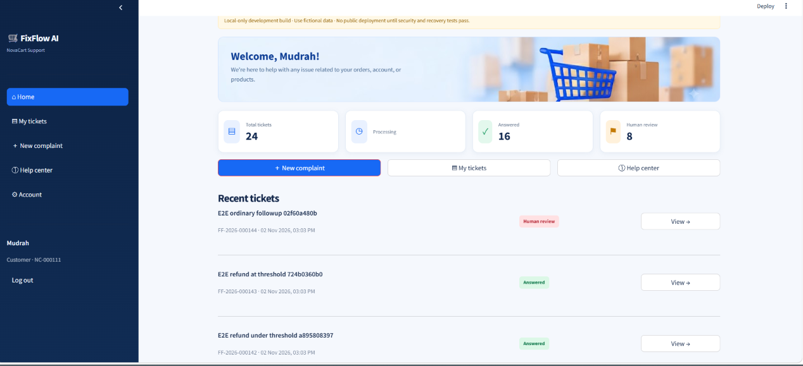

# FixFlow AI — Multi-Agent Customer Support System

**Project:** NovaCart customer support demo  
**Status:** Local-first buildathon implementation; not deployed for real transactions  
**Frameworks:** Microsoft AutoGen · FastAPI · Streamlit · Hybrid RAG

FixFlow AI is a multi-agent customer support application for the **fictional e-commerce company NovaCart**. Customers can submit complaints and track tickets, while a background worker coordinates specialized AI agents to classify requests, retrieve approved policy evidence, draft responses and record outcomes. Sensitive cases are escalated to a human administrator.

> **Demo only:** NovaCart data is fictional. The application does not execute real refunds or payments. Local test results are not a production security certification.

## Features

- **Four-agent workflow:** Query → Knowledge → Resolution → Log.
- **Hybrid policy retrieval:** FAISS vector search + BM25 keyword retrieval, combined using Reciprocal Rank Fusion (RRF), with source citations.
- **Customer portal:** Registration, login, complaints, ticket history, follow-ups and help-center questions.
- **Human review:** Administrator workflows for escalations, sensitive cases and refund requests.
- **Persistent records:** SQLite-backed tickets, reviews and audit information.
- **Supporting evidence:** Customer-uploaded evidence stored in a private runtime directory.
- **Controlled integrations:** Read-only MCP capabilities and restricted public web search when appropriate.
- **Admin reporting:** Ticket management, audit log and CSV complaint export.
- **Automated validation:** Pytest and Playwright coverage for backend workflows and browser journeys.

## Architecture

```text
Customer / Administrator
         |
         v
Streamlit UI (frontend/app.py)
         |  REST API
         v
FastAPI backend (backend/main.py) ---- SQLite (tickets, reviews, audit)
         |
         v
Background worker (backend/worker/main.py)
         |
         v
AutoGen agent team (backend/agents/team.py)
  Query -> Knowledge -> Resolution -> Log
              |
              +-- Hybrid RAG (FAISS + BM25 + RRF)
              |       +-- Approved NovaCart SOP PDFs
              +-- Read-only MCP tools (where applicable)
              +-- Restricted public web research (when needed)
         |
         v
Customer response / human review / persisted ticket outcome
```

The **UI, API and worker are separate processes**. The API and worker enforce workflow decisions; the Streamlit interface is not the sole authority for sensitive actions.

### Agent responsibilities

| Agent | Role |
|---|---|
| **Query Agent** | Interprets the complaint and identifies its category and relevant context. |
| **Knowledge Agent** | Retrieves relevant approved company policy evidence. |
| **Resolution Agent** | Drafts a response using available evidence and the case context. |
| **Log Agent** | Produces a structured outcome for ticket logging and escalation handling. |

The backend persists the result and applies safety and review controls. Agent-generated text alone does not authorize a financial action.

## Safety and escalation rules

- **Refund requests of ₹500 or more (₹500 inclusive)** require backend-enforced human review, including requests raised during ticket follow-ups.
- **Fraud, legal and payment-dispute cases** escalate regardless of amount.
- **Refunds and other major remedial actions require a verified order ID and appropriate supporting evidence.** Damaged/defective-item cases require relevant photo evidence.
- If details or evidence are missing, the application requests verification or routes the case to human review; it must **not automatically execute a transaction**.
- **No real refunds or payment transactions** are executed in this demo.
- Answers should be grounded in approved sources; private customer data and evidence must not be exposed through public documentation or repository files.

## Technology stack

| Layer | Technology |
|---|---|
| Frontend | Streamlit |
| API | FastAPI, Uvicorn |
| Agent orchestration | Microsoft AutoGen |
| Language model | OpenAI API |
| Retrieval | FAISS, BM25, Reciprocal Rank Fusion |
| Database | SQLite |
| External tools | MCP, restricted web search |
| Testing | Pytest, Playwright |
| Language | Python |

Dependency versions are defined in [`requirements.txt`](requirements.txt).

## Project layout

```text
fixflow-ai/
├── backend/
│   ├── main.py                 # FastAPI entry point
│   ├── agents/team.py          # AutoGen team
│   ├── worker/main.py          # Background processing
│   ├── rag/hybrid.py           # Hybrid retrieval
│   ├── api/                    # API routes
│   ├── auth/                   # Authentication
│   ├── db/                     # Persistence
│   ├── mcp_server/             # MCP integration
│   └── services/               # Domain services and controls
├── frontend/app.py            # Streamlit application
├── policies/                  # NovaCart SOP PDFs
├── scripts/build_index.py     # Local policy indexing
├── tests/                     # Automated tests
├── eval/                      # Evaluation resources
├── screenshots/               # Application screenshots
├── .env.example               # Configuration template (no secrets)
├── requirements.txt
└── README.md
```

Generated indexes, databases, uploaded evidence and virtual environments are **not included** in the public submission archive.

## Local installation (Windows CMD)

### 1. Prerequisites

- Python 3.10+ **with a version compatible with the pinned dependencies**
- `pip` and an internet connection for dependency installation
- An OpenAI API key for model-backed functionality
- The project files, including the six SOP PDFs in `policies/`

### 2. Create and activate a virtual environment

Open CMD in the extracted project directory:

```cmd
python -m venv venv
venv\Scripts\activate
python -m pip install -r requirements.txt
```

### 3. Configure environment variables

```cmd
copy .env.example .env
```

Edit `.env` and supply the settings needed by your local configuration, including your OpenAI API key. For example:

```env
OPENAI_API_KEY=replace_with_your_own_key
FIXFLOW_API_URL=http://127.0.0.1:8000
```

Use `.env.example` as the authoritative template for any additional supported settings. **Never upload `.env` or real credentials.**

### 4. Build the local RAG index

From the project root, with the virtual environment active:

```cmd
python -m scripts.build_index
```

The script loads local configuration, builds the hybrid index from the configured policy sources and prints an **`Indexed policy chunks:`** count. The generated local index is deliberately excluded from the submission ZIP and can be recreated from the provided policy PDFs.

### 5. Start the three application processes

Open **three separate CMD terminals** in the project root. Activate the virtual environment in each terminal.

**Terminal 1 — FastAPI**

```cmd
venv\Scripts\activate
python -m uvicorn backend.main:app --host 127.0.0.1 --port 8000
```

API docs: <http://127.0.0.1:8000/docs>

**Terminal 2 — Streamlit**

```cmd
venv\Scripts\activate
set FIXFLOW_API_URL=http://127.0.0.1:8000
python -m streamlit run frontend/app.py --server.address 127.0.0.1 --server.port 8501
```

Application: <http://127.0.0.1:8501>

**Terminal 3 — background worker**

```cmd
venv\Scripts\activate
python -m backend.worker.main
```

The worker handles queued complaint processing. Keep the API, UI and worker running while demonstrating end-to-end ticket processing.

## Demonstration scenarios

These scenarios illustrate the workflow and safety rules; use fictional customer and order information only.

| Scenario | Expected demonstration |
|---|---|
| General delivery or return question | Policy-grounded answer with supporting citations |
| Standard support complaint | Ticket created, processed and visible in customer history |
| Refund request of **₹499** | Evaluated against other applicable controls; no automatic real refund |
| Refund request of **₹500** | Human review required |
| Damaged item without order verification or photo | Missing information collected or human review; no transaction |
| Fraud, legal or payment dispute | Escalation irrespective of amount |
| Administrator review | Review decision, ticket state and audit record visible |

## Application screenshots

Screenshots are stored in [`screenshots/`](screenshots/). **Replace or rearrange the sections below as you prefer.** The paths match the filenames in the current submission archive.

### Dashboard



### Customer help center


### My tickets


### Resolved ticket


### Resolve option after reply


### Human review


### Audit log


### CSV export


> Before public submission, inspect every screenshot for personal data, API keys, private evidence or other sensitive information.

## Testing and validation

The repository includes Pytest tests and Playwright browser tests. Run tests against **isolated test databases and services**, never against real customer data.

**Non-browser test suite:**

```cmd
python -m pytest -q -p no:playwright --ignore=tests/e2e/test_portal_ui.py --ignore=tests/e2e/test_customer_complaint_journey.py
```

**Project local validation script:**

```cmd
python scripts/run_local_validation.py --e2e
```

**Additional targeted tests:**

```cmd
python -m pytest -q tests/test_phase10_consolidated.py --tb=short
python -m pytest -q tests/test_resolved_evidence_upload.py --tb=short
```

**Previously reported local results (2026-11-02):** 327 backend/offline tests passed, 8 browser E2E tests passed, 7 consolidated phase-10 tests passed and 1 evidence-upload test passed. These sets may overlap; the numbers are **reported local results**, not tests rerun as part of this README update.

### Quick quality checks

```cmd
python -m compileall -q backend frontend scripts
python -m pip check
```

These checks do not replace the test suite or an end-to-end manual demonstration.

## Troubleshooting

| Problem | What to check |
|---|---|
| UI cannot reach backend | Confirm FastAPI is running on port 8000 and `FIXFLOW_API_URL` is correct. |
| Ticket remains pending | Confirm the background worker is running and inspect its terminal output. |
| Knowledge answers lack citations or retrieval fails | Confirm the SOP PDFs are present and rerun `python -m scripts.build_index`. |
| Model request fails | Check `OPENAI_API_KEY`, enabled model settings, connectivity and API access. |
| Port already in use | Stop the conflicting local process or adjust the port and matching URL configuration. |
| Browser tests interfere with local data | Use isolated test services, databases and evidence directories. |

## Privacy and submission notes

Do **not** include the following in a public repository or submission ZIP:

- `.env` or any real credentials
- `private_evidence/` and customer-uploaded files
- Local SQLite databases (`*.sqlite3`, `*.db`)
- Generated local RAG indexes
- Virtual environments, caches, private mailboxes or local audit exports

The `private_evidence/` directory is created by the application when needed for valid evidence uploads; it does not need to be distributed with the project.

A safe submission should contain the source code, approved fictional policy documents, dependency list, `.env.example`, tests, screenshots and this README. Verify the archive contents before sharing it.

## Scope and limitations

FixFlow AI demonstrates local multi-agent customer support, retrieval-grounded responses, escalation, human review and auditability. It is **not a production payment system**, and no real refund or financial transaction is performed. A production deployment would require separate security, privacy, operational and persistence review.

## Author

Developed for the **Social Eagle AI Engineering Program — Multi-Agent Customer Support Automation Buildathon**.
