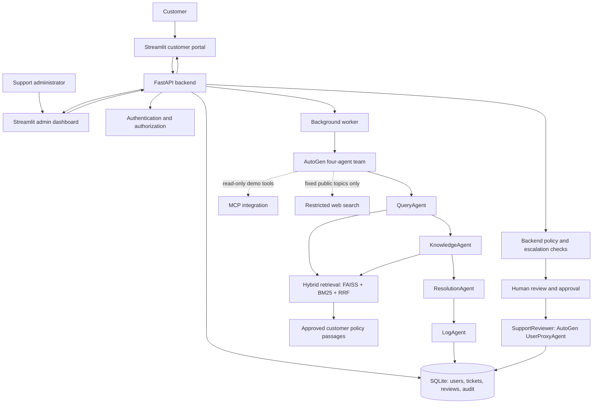
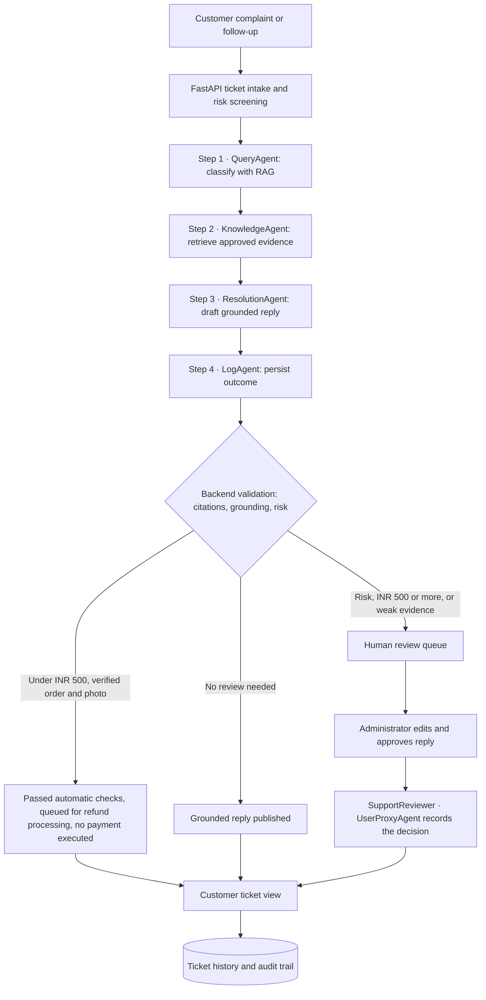

# FixFlow AI — NovaCart Multi-Agent Customer Support

FixFlow AI is a customer-support app built with **Microsoft AutoGen** (four agents), **hybrid RAG** (FAISS + BM25 + RRF), a **FastAPI** backend and a **Streamlit** UI. It classifies complaints, answers only from approved policy evidence with citations, and escalates risky or unsupported cases to a human.

## Features

- Customer portal: register, verify email, sign in, raise tickets, follow up, upload damage photos, Help Center without a ticket.
- **Four AutoGen agents** in a `RoundRobinGroupChat`; each agent's output is visible in the UI.
- Answers grounded in **15 approved passages** (SOP excerpts plus one app-help passage for password reset) with exact citation IDs; a backend grounding guard blocks invented windows, dates, policies, app features and staff-contact promises.
- Escalation for refunds of **₹500 or more**, fraud, legal threats, payment disputes, missing verification or weak evidence (red badge; resolved tickets are green).
- **Human-in-the-loop:** an admin edits and approves escalated replies; an AutoGen `UserProxyAgent` (`SupportReviewer`) records the decision.
- Complaint log table with CSV download, admin dashboard (category, status, average urgency), full audit trail.
- QueryAgent emotion labels (Angry, Frustrated, Worried, Confused, Happy, Sad, Neutral) affect tone only, never escalation.
- **English, Tamil and Tanglish:** the language is detected and logged; Tamil questions are answered from the same English policy evidence, checked in English, then translated, with the verified English reply kept below.

## Architecture



| Agent | Responsibility |
| --- | --- |
| **QueryAgent** | Classifies category, urgency, emotion and risk flags; authorizes nothing |
| **KnowledgeAgent** | Retrieves approved passages and cites their exact IDs |
| **ResolutionAgent** | Drafts a reply supported by the cited passages, states evidence limits, flags human review |
| **LogAgent** | Persists the outcome, citations and escalation reason |



Backend validation is authoritative over every agent output. Missing or invalid agent handoffs fail closed to human review.

## Safety rules

| Request | Outcome |
| --- | --- |
| Damaged item **under ₹500**, owned delivered order, genuine photo, first automatic acceptance this year | Queued for refund processing, no human step; the customer is told no money has been refunded yet |
| Any refund **₹500 or more** (exactly ₹500 included) | Always human review |
| Fraud, legal threat, payment dispute | Always human review, any amount |
| No matching policy or weak evidence | Honest limitation and escalation, never an invented policy |

Details: [docs/DESIGN.md](docs/DESIGN.md) (refund checks, grounding guard, human-in-the-loop, complaint log, limitations).

## Setup (Windows, fresh clone)

Requires Python 3.11, an OpenAI API key, and Docker Desktop for the one-command stack.

```cmd
git clone https://github.com/poovizhimangaipatchirajan/AI-Customer-Support-Multigent--Autogen.git fixflow-ai
cd fixflow-ai
python -m venv venv
venv\Scripts\activate
pip install -r backend/requirements.txt
pip install -r frontend/requirements.txt
copy .env.example .env
```

Set `OPENAI_API_KEY` in `.env` (and Gmail SMTP values for real verification emails). Never commit `.env`. The frontend reads the backend address from `FIXFLOW_API_URL`.

```cmd
:: build the approved policy index once (one small embedding call)
python scripts/rebuild_customer_index_staging.py --activate

:: create a local admin (12+ character password)
python scripts/create_admin.py
```

**Run with Docker (recommended):** `docker compose up -d --build`, then open http://127.0.0.1:8501.

**Or run locally in three terminals** (each with `venv\Scripts\activate`):

```cmd
python -m uvicorn backend.main:app --host 127.0.0.1 --port 8000
python -m backend.worker.main
streamlit run app.py
```

`FIXFLOW_LOCAL_DEMO=1` enables local demo helpers (fictional sample orders); set it to `0` on any public deployment.

## Results

| Check (2026-11-05) | Result |
| --- | --- |
| Offline test suite (`python -m pytest -q`) | **974 passed**, 36 skipped (opt-in live tests) |
| Live six official scenarios + TC02/TC07/TC08 | All outcomes as expected; see [docs/TESTING.md](docs/TESTING.md) |
| Retrieval evaluation, 30 labelled questions | 20/20 answerable questions find the right source in top 4; 0 internal-SOP leaks |
| Playwright browser journeys | 19 passed, screenshots below |

The broken-blender replacement is escalated on purpose: the approved policy does not say which return category a blender belongs to, and a replacement is a consequential remedy that needs a human.

Commands for tests, live runs, evaluation and screenshots: [docs/TESTING.md](docs/TESTING.md).

## Screenshots

Produced by `tests/e2e/test_screenshot_journeys.py` against the Docker stack with fictional accounts.

| # | Screenshot | Shows |
| --- | --- | --- |
| 3 | [Resolved: where is my order](evidence/screenshots/03_resolved_where_is_my_order.png) | Green badge, cited shipping policy, no invented ETA |
| 4 | [Resolved: return shoes](evidence/screenshots/04_resolved_return_shoes.png) | 14-day fashion window, four agent steps |
| 5 | [Resolved: forgot password](evidence/screenshots/05_resolved_forgot_password.png) | Identity-verification guidance |
| 6 | [Escalated: broken blender](evidence/screenshots/06_escalated_broken_blender.png) | Red badge, no replacement promised |
| 7 | [Escalated: charged three times + lawyer](evidence/screenshots/07_escalated_billing_lawyer.png) | Legal threat and payment dispute |
| 8 | [Escalated: corporate gift cards](evidence/screenshots/08_escalated_unsupported_giftcards.png) | No matching policy, honest reply |
| 9 | [Own case 1: refund under ₹500](evidence/screenshots/09_own_case_auto_refund_under_500.png) | Passed automatic checks, no payment executed ([sample orders](evidence/screenshots/09a_customer_sample_orders.png)) |
| 10 | [Own case 2: refund ₹600](evidence/screenshots/10_own_case_refund_600_human_review.png) | ₹500+ always goes to human review |
| 11 | [Help Center](evidence/screenshots/11_help_center_no_ticket.png) | Grounded answer, no ticket |
| 12 | [Prompt injection](evidence/screenshots/12_prompt_injection_blocked.png) | Escalated safely, nothing disclosed |
| 13 | [Agent workflow](evidence/screenshots/13_admin_agent_workflow.png) · [agent outputs](evidence/screenshots/13b_admin_agent_outputs.png) | Each agent's own output |
| 14 | [Escalation queue](evidence/screenshots/14_admin_escalation_queue.png) | Escalated tickets with reasons |
| 15 | [Refund review decision](evidence/screenshots/15_admin_refund_review_decision.png) | Admin assessment, no payment executed |
| 16 | [Human-in-the-loop](evidence/screenshots/16_admin_human_in_the_loop_approval.png) | `SupportReviewer` step after the four agents |
| 17 | [Customer refund status](evidence/screenshots/17_customer_refund_status_after_approval.png) | Approved review shown to the customer |
| 18 | [Admin dashboard](evidence/screenshots/18_admin_dashboard.png) | Totals, average urgency, charts |
| 19 | [Complaint log table](evidence/screenshots/19_complaint_log_table.png) | All required columns, CSV download |
| 20 | [Complaint log CSV](evidence/screenshots/20_complaint_log_csv.png) | Outcome and escalation reasons |

Also: [registration](evidence/screenshots/01_registration_and_login.png), [customer home](evidence/screenshots/02_customer_home.png).

## Project structure

```text
app.py                  one-command Streamlit launcher (streamlit run app.py)
backend/agents/team.py  four AutoGen agents and the human-review team
backend/rag/            FAISS + BM25 + RRF retrieval over the approved index
backend/services/       risk screening, grounding guard, refunds, complaint log
backend/worker/         background worker: agent runs, leases, recovery
backend/main.py         FastAPI API
frontend/               Streamlit UI and API client
policies/               source SOP PDFs
eval/                   retrieval evaluation set and reports
tests/                  offline tests, opt-in live and Playwright tests
evidence/               screenshots and run evidence
docs/                   design and testing details
```
