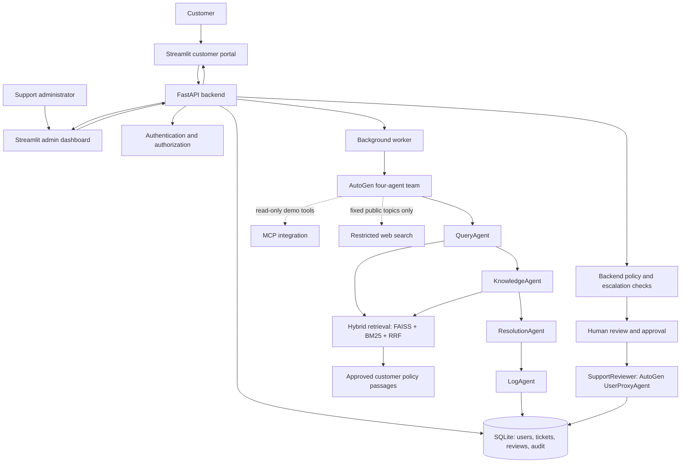
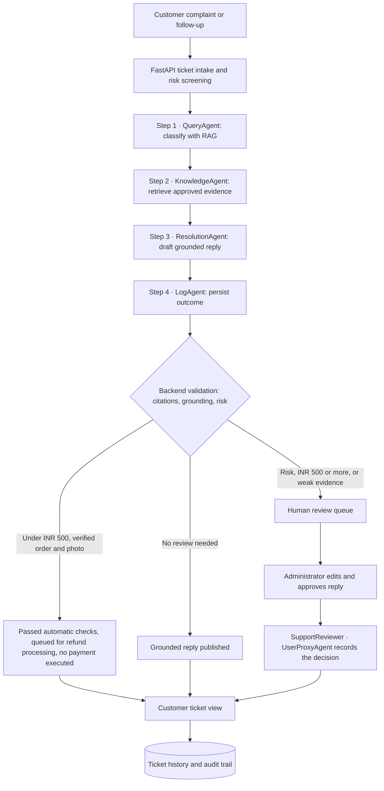

# FixFlow AI — NovaCart Multi-Agent Customer Support

FixFlow AI is a local-first customer-support application built with a **FastAPI backend**, **Streamlit frontend**, **AutoGen multi-agent workflow**, and **hybrid retrieval-augmented generation (RAG)**. It helps process customer complaints, retrieve policy evidence, draft grounded responses, and route sensitive cases to human administrators.

> Local validation has passed the reported regression and targeted demo gates. This does **not** certify production security, live payment processing, or readiness to handle real customer data.

## Features

- Customer registration, verification, sign-in, ticket submission, and ticket follow-ups.
- Customer-specific ticket access and administrative review workflows.
- Four-agent AutoGen support workflow for query handling, knowledge retrieval, resolution, and outcome logging.
- Hybrid **FAISS + BM25** retrieval combined with **Reciprocal Rank Fusion (RRF)** and evidence/citation controls.
- Read-only MCP integration and restricted public web research for appropriate current-information questions.
- SQLite-backed tickets, audit records, AI results, and durable refund-review decisions.
- Worker leases, heartbeats, retry/recovery handling, stale-result protection, and idempotent processing safeguards.
- Administrative queue, draft review/publishing, audit inspection, and CSV export.
- **Human-in-the-loop with AutoGen `UserProxyAgent`:** when a support specialist approves an escalated reply, the worker runs a review conversation in which `SupportReviewer` (a `UserProxyAgent`) states the human decision and LogAgent records it; the UI shows it as a fifth workflow step.
- Admin dashboard: tickets per category, resolved vs escalated, average urgency.

## Safety and refund rules

- **Refund requests of ₹500 or more, including exactly ₹500, require backend-enforced human review.** This includes refund requests introduced in follow-up messages.
- Fraud, legal, and payment-dispute concerns are escalated independently of the amount.
- The application **does not execute real refunds or payment transactions**.

### Refund flow

| Request | Automatic checks | Outcome |
|---|---|---|
| Damaged/defective item, **under ₹500** | Clear amount, no risk flags, linked order owned by the customer and **delivered**, amount ≤ order total, a genuine photo uploaded, order never auto-refunded, **≤ 1 automatic acceptance per customer per 365 days** | All pass → **queued for refund processing** without a human review step (ticket Answered, refund status "passed the automatic eligibility checks"). Any fail → asked for details or human review |
| Any refund **₹500 or more** | Same order and evidence checks | **Always human review**: admin assessment and APPROVED/REJECTED decision |
| Fraud, legal threat, payment dispute | — | **Always human review**, any amount |

**How this fits the rule that refunds are never executed automatically:** passing the automatic checks is eligibility triage, not a payment and not an approval. Nothing is refunded by the application; the customer is told explicitly that no money has been refunded yet. Every request of ₹500 or more, and every request with a fraud, legal, dispute, amount or evidence concern, still goes to a human.

Photos are confirmed as genuine uploaded images, not inspected for content; the per-customer annual limit is the fraud control. Every acceptance and decision is audited and records `execution_status: NOT_CONFIGURED`. A production deployment would add the payment provider's refund API (idempotent, with transaction reference) before telling customers a refund was initiated, plus sampling audits of automatic acceptances.
- AI answers should be grounded in approved evidence and must not invent order status, refund status, payment outcomes, or delivery estimates.
- Internal-only policy material must not be disclosed to customers; customer records must remain isolated by account.
- Public web search must not disclose private customer information.

## System architecture

FixFlow AI separates the customer-facing interface, authenticated API, background processing, and evidence-backed AI workflow. The diagram below is a conceptual map of the documented components; it is not a claim that every integration is invoked for every ticket.



### Four-agent workflow

The AutoGen team is organized around four distinct responsibilities:

| Agent | Responsibility | Typical output |
| --- | --- | --- |
| **QueryAgent** | Understand the complaint and classify category, urgency, and sentiment. | Structured issue summary and classification |
| **KnowledgeAgent** | Retrieve relevant passages from approved documents using hybrid RAG and preserve source references. | Evidence passages and citations |
| **ResolutionAgent** | Draft a customer-facing response grounded in the retrieved evidence; avoid inventing policies or transaction outcomes. | Evidence-backed response draft |
| **LogAgent** | Record the ticket outcome and support the escalation/audit workflow. | Logged result and escalation information |



**Important:** The flowchart shows the logical support process, not a guarantee that the AI can approve or execute financial transactions. Backend checks and human review are authoritative. Refund requests of **₹500 or more** (including ₹500), fraud/legal/payment disputes, missing order verification, and missing required evidence must be handled under the applicable safeguards. **No refund is automatically executed.**

### Hybrid RAG and supporting services

- **FAISS** supplies vector-similarity retrieval; **BM25** supplies lexical retrieval; **Reciprocal Rank Fusion (RRF)** combines their ranked results.
- Retrieved policy/FAQ passages support citations and grounding checks; insufficient evidence must not become an invented policy answer.
- **MCP** is described as read-only, and public web search is restricted to appropriate current-information needs. Neither should expose private customer records.
- **SQLite** stores ticket and review state, while the separate worker handles AI processing and recovery. The admin interface supports review, publication, and audit inspection.
- The **frontend, API, and worker run as separate local processes**. Do not use the isolated test database for normal application work.

## Local setup — Windows CMD

Requirements: Python 3.11, the backend and frontend dependency files (`backend/requirements.txt`, `frontend/requirements.txt`), and the configured local environment variables. Use the project's existing virtual environment if it is already working; do not recreate it unnecessarily.

```cmd
cd fixflow-ai
venv\Scripts\activate

pip install -r backend/requirements.txt
pip install -r frontend/requirements.txt
copy .env.example .env
```

Dependencies are split per service (there is no root `requirements.txt`): `backend/requirements.txt` covers the FastAPI API, AutoGen agents, RAG and the worker; `frontend/requirements.txt` covers the Streamlit UI. Each Docker image installs its own file.

Edit `.env` and set `OPENAI_API_KEY` (and the SMTP values for email verification). The frontend reads the backend address from `FIXFLOW_API_URL` (default `http://127.0.0.1:8000`); no backend URL is hardcoded. `backend/requirements.txt` and `frontend/requirements.txt` are the per-image lists used by Docker.

Keep API keys and credentials in local environment configuration. **Never commit `.env`, SQLite databases, local mailbox contents, or credentials.**

### Start the API

In terminal 1:

```cmd
cd fixflow-ai
venv\Scripts\activate
python -m uvicorn backend.main:app --host 127.0.0.1 --port 8000
```

### Start the frontend

From the repository root, `streamlit run app.py` starts the UI with one command. The root `app.py` is a thin launcher for the Streamlit UI in `frontend/app.py`.

In terminal 2:

```cmd
cd fixflow-ai
venv\Scripts\activate
streamlit run app.py --server.address 127.0.0.1 --server.port 8501
```

Open **http://127.0.0.1:8501**.

### Start the background worker

In terminal 3, activate the same virtual environment and ensure the required model, retrieval, and integration settings are available:

```cmd
cd fixflow-ai
venv\Scripts\activate
python -m backend.worker.main
```

For a fresh installation, build the policy index using the project's existing configured ingestion procedure before expecting RAG answers. Do not rebuild or overwrite an already validated local index unnecessarily.

## Local test validation

### Test layout

`tests/` holds **23 feature-grouped files** (908 offline tests) plus `tests/conftest.py`. The conftest makes a plain `python -m pytest` **offline and side-effect free**: unless a live flag is set, it replaces the OpenAI/Serper keys with dummies, points OpenAI at an unroutable address and disables SMTP, so tests can never make paid calls or send email.

| File | Covers |
| --- | --- |
| `test_auth_accounts.py` | Registration, verification, login, sessions, evidence-upload security |
| `test_risk_screening.py` | ₹500 inclusive threshold, fraud/legal/payment-dispute flags, multilingual risk, amount attribution |
| `test_refund_workflow.py` | Refund clarification, follow-ups, approval prerequisites, review decisions, case closure |
| `test_auto_refund.py` | Under-₹500 automatic eligibility checks and the one-per-customer-per-year limit |
| `test_grounding_return_windows.py`, `test_grounding_guard.py`, `test_quantitative_grounding.py` | Return-window anchors, category windows, category-membership repair, numeric claims |
| `test_evidence_quality.py`, `test_customer_evidence_domains.py` | Citation sufficiency per policy domain, cited-text support, evidence fallbacks |
| `test_retrieval.py`, `test_customer_index_visibility.py` | Hybrid FAISS + BM25 + RRF ranking, approved-index validation, internal-SOP isolation |
| `test_approved_only_lane.py` | Approved-only index runtime (run in its own process, see below) |
| `test_agents_prompts.py` | Four-agent prompts, structured citation handoff |
| `test_human_review.py` | Human-in-the-loop: `UserProxyAgent` records the specialist's decision; LogAgent cannot alter it; retries and failure are audited |
| `test_worker.py` | Leases, recovery, retry exhaustion, fail-closed publication |
| `test_api_journeys.py` | End-to-end customer/admin API journeys, customer isolation |
| `test_help_center.py`, `test_mcp_web_search.py` | Help Center answers, MCP tools, restricted web search |
| `test_logging_ui.py` | Complaint-log columns and CSV, ticket classification, UI error handling |
| `test_scenarios.py` | Offline buildathon and realistic customer scenarios |
| `test_buildathon_live_six_scenarios.py` and 3 other live files | **Opt-in paid** live runs (skipped by default) |
| `tests/e2e/test_screenshot_journeys.py` | **Opt-in** Playwright browser journeys against the running Docker stack; saves the numbered screenshots in `evidence/screenshots/` |

### Run the regression (PowerShell, from the project root)

```powershell
python -m pytest -q
$env:FIXFLOW_CUSTOMER_INDEX_MODE = "approved_only"; python -m pytest -q tests/test_approved_only_lane.py; Remove-Item Env:FIXFLOW_CUSTOMER_INDEX_MODE
```

| Batch (run 2026-11-05) | Result |
| --- | --- |
| Full offline suite | **908 passed, 36 skipped** (skipped = opt-in live tests, not passes) |
| Approved-only lane | **35 passed** |

### Live acceptance (opt-in, uses OpenAI)

```powershell
$env:FIXFLOW_RUN_BUILDATHON_LIVE = "1"; $env:FIXFLOW_CUSTOMER_INDEX_MODE = "approved_only"; python -m pytest -q -s tests/test_buildathon_live_six_scenarios.py
```

| Scenario (live, approved-only index, 2026-11-05) | Outcome |
| --- | --- |
| Where is my order? | ANSWERED, cites the in-transit and delivered-not-received shipping passages; no invented ETA or tracking |
| Return shoes bought last week | ANSWERED (occasionally routed to review when the agent flags a case decision); 14-day fashion window, conditions, no invented start date |
| Forgot password | ANSWERED, identity verification required |
| Broken blender, replacement | ESCALATED to human review, with policy guidance (see note below) |
| Charged three times, bank and lawyer | ESCALATED (`LEGAL`, `PAYMENT_DISPUTE`) |
| Gift cards for 500 employees | ESCALATED, no citations (no matching policy) |
| TC02 fashion return / TC07 damaged cable ₹299 / TC08 wrong-size headphones | ANSWERED / ESCALATED / ESCALATED |

**Why some "Resolved" cases are escalated on purpose.** The assignment expects the broken-blender request (test 4) to be resolved. FixFlow answers it with the grounded guidance it can support (Dead-on-Arrival assessment, technician diagnosis, required box and accessories) and then routes the **replacement decision** to a human, because the approved policy does not say which return category a blender belongs to and a replacement is a consequential remedy that must not be granted automatically. TC07 (damaged cable, no order or photo supplied) escalates for the same reason: verification is missing, not policy. When the customer links a delivered order and uploads a photo, the under-₹500 automatic path accepts it (screenshot 9).

ANSWERED is never proof that a refund or replacement happened; no payment is executed.

### Retrieval evaluation (`python -m eval.evaluate --mode live --k 4`)

30 labelled questions in `eval/golden_cases.json`, scored on the **approved-only index the app uses** (report: `eval/retrieval_report_approved_only.json`).

| Question group | Result |
| --- | --- |
| 20 specific questions answerable from approved customer passages | **20/20 correct source in top 4** |
| 4 questions on internal or excluded topics (fulfilment channels, dispatch manifests, UPI rails, 3-D Secure) | Correctly **no customer passage returned** |
| 6 vague template questions (e.g. "What does the policy say about refund?") | Abstained: several passages tie, so the conservative ranker returns none rather than guess |
| Internal-SOP leaks | **0** |

Overall source recall is 67% because the golden set was written against the full SOP PDFs; the offline keyword baseline over all customer chunks (`--mode offline`) reaches 90% recall without the approval and abstention safeguards.

### Browser screenshots (Playwright, opt-in, uses OpenAI through the running worker)

```powershell
docker compose up -d
$env:FIXFLOW_RUN_E2E = "1"; python -m pytest tests/e2e -q
```

Each run creates fresh fictional accounts directly in the Docker database (no registration email is sent) and writes `01_…` to `20_…` screenshots to `evidence/screenshots/`.

### Load and timeout handling

| Situation | Behaviour |
| --- | --- |
| Many tickets at once | Ticket creation only queues work; one background worker processes tickets in order, and the UI refreshes progress every 2 s |
| Slow or stuck AI call | Each model call is limited to 45 s (2 retries) and each ticket's whole agent run to 150 s; a timed-out run is retried once from a clean state, then escalated to human review |
| Worker crash | 180 s lease with heartbeat; the job is requeued once, then escalated; never processed twice |
| Help Center provider slow or rate-limited | 10 s embedding limit; the user gets "The Help Center is busy right now…" (HTTP 503 + Retry-After) |
| Database busy (SQLite lock) | HTTP 503 "The service is busy…" with Retry-After instead of a server error |
| Frontend waiting on the API | 30 s limit and a clear timeout or busy message, never a crash |

Scaling beyond a demo would mean PostgreSQL and several worker processes; the single worker is a deliberate choice that keeps ordering and recovery simple.

### Known limitations

- **Late or undelivered orders** are covered by one curated passage (in transit within the estimated delivery date is not treated as lost; past it, contact support for verification). There is still no live tracking, so replies never state an order's actual status.
- **Product-to-category mapping is not in the approved policy.** Replies never claim which category an item belongs to; a deterministic repair removes such claims and says the category is confirmed during verification.
- **Short wrong-size/colour exchange questions (TC08) can retrieve no passage** above the similarity floor; the case escalates honestly instead of citing the wrong policy. Thresholds are deliberately not lowered.
- `06_Escalations_and_Soft_Skills_SOP.pdf` is internal guidance and is intentionally excluded from customer retrieval and from the 30-case evaluation set in `eval/golden_cases.json`.
- Photos are confirmed as genuine images but never inspected for content; no payment provider is connected.

### Two additional safety cases

1. **Refund without verified order ID:** the app must request verification or human review, and never execute a refund.
2. **Damaged product without required photo evidence:** the app must request evidence or route to human review; never execute a refund.

Use the screenshot inventory below for the available captures. The automated test outcomes and screenshots are distinct evidence; do not treat an image as proof of a scenario it does not visibly demonstrate.

### Four-Agent Workflow Verification

The following targeted tests passed:

| Test | Result |
|---|---|
| Live four-agent workflow with synthetic policy evidence | PASS |
| Agent events are observed, not generated | PASS |

These tests provide evidence of workflow integration and authentic
agent-event recording.

See `evidence/screenshots/` for the canonical screenshot inventory. Add any verified terminal test captures there rather than maintaining a second root-level screenshot directory.

## Submission screenshot gallery

All screenshots in `evidence/screenshots/` are produced by the Playwright journeys in `tests/e2e/test_screenshot_journeys.py` against the running Docker stack, using fictional accounts and orders. Images show the visible UI only; backend safety is proven by the automated tests above.

| # | Screenshot | What it shows |
| --- | --- | --- |
| 1 | [Registration and login](evidence/screenshots/01_registration_and_login.png) | Login / registration with email verification |
| 2 | [Customer home](evidence/screenshots/02_customer_home.png) | Customer dashboard |
| 3 | [Resolved: where is my order](evidence/screenshots/03_resolved_where_is_my_order.png) | **Resolved** (green), cited shipping policy, no invented ETA |
| 4 | [Answered: return shoes](evidence/screenshots/04_resolved_return_shoes.png) | 14-day fashion window and conditions, four agent steps |
| 5 | [Answered: forgot password](evidence/screenshots/05_resolved_forgot_password.png) | Identity-verification guidance |
| 6 | [Escalated: broken blender](evidence/screenshots/06_escalated_broken_blender.png) | **Human review** (red), no replacement promised |
| 7 | [Escalated: charged three times + lawyer](evidence/screenshots/07_escalated_billing_lawyer.png) | Legal threat and payment dispute escalated |
| 8 | [Escalated: corporate gift cards](evidence/screenshots/08_escalated_unsupported_giftcards.png) | No matching policy, honest reply, no citations |
| 9 | [Own case 1: auto refund under ₹500](evidence/screenshots/09_own_case_auto_refund_under_500.png) | Delivered order + photo → passed automatic checks, queued for refund processing, no payment executed ([sample orders](evidence/screenshots/09a_customer_sample_orders.png)) |
| 10 | [Own case 2: refund ₹600](evidence/screenshots/10_own_case_refund_600_human_review.png) | ₹500+ always requires human review |
| 11 | [Help Center](evidence/screenshots/11_help_center_no_ticket.png) | Grounded answer with source, no ticket created |
| 12 | [Prompt injection](evidence/screenshots/12_prompt_injection_blocked.png) | Escalated safely, nothing disclosed or approved |
| 13 | [Admin: agent workflow](evidence/screenshots/13_admin_agent_workflow.png) · [agent outputs](evidence/screenshots/13b_admin_agent_outputs.png) | Each agent's step and its own output |
| 14 | [Admin: escalation queue](evidence/screenshots/14_admin_escalation_queue.png) | Escalated tickets with reasons |
| 15 | [Admin: refund review decision](evidence/screenshots/15_admin_refund_review_decision.png) | Evidence inspected, assessment, APPROVED, no payment executed |
| 16 | [Human-in-the-loop approval](evidence/screenshots/16_admin_human_in_the_loop_approval.png) | **SupportReviewer** (`UserProxyAgent`) step after the four agents |
| 17 | [Customer refund status](evidence/screenshots/17_customer_refund_status_after_approval.png) | Approved review shown to the customer, no payment executed |
| 18 | [Admin dashboard](evidence/screenshots/18_admin_dashboard.png) | Totals, average urgency, status and category charts |
| 19 | [Complaint log table](evidence/screenshots/19_complaint_log_table.png) | All Section 7 columns, CSV download |
| 20 | [Complaint log CSV](evidence/screenshots/20_complaint_log_csv.png) | Downloaded CSV: readable outcome and escalation reasons |

### Screenshot folder and Git hygiene

- Do not maintain a second root-level `screenshots/` folder. Consolidate confirmed submission images into `evidence/screenshots/` after comparing duplicates; do not delete originals before checking them.
- `.gitignore` explicitly allows `evidence/screenshots/*.png|jpg|jpeg` and ignores local backups (`*.bak*`, `local_customer_index.backup-*/`), regression logs, `docker_data/`, private evidence, `.env` and complaint-log CSV/XLSX exports.
- Never include `.env`, SQLite databases, private customer uploads, `private_evidence/`, virtual environments, or API credentials in the submission.
- Check screenshot contents for customer names, emails, order IDs, and other private information; redact or replace sensitive captures before publishing.

### Buildathon submission checklist

| Requirement | Documentation / evidence |
| --- | --- |
| Four AutoGen agents, each with a clear single responsibility | [Four-agent workflow](#four-agent-workflow) and backend agent implementation |
| KnowledgeAgent uses documents and identifies sources | [Hybrid RAG and supporting services](#hybrid-rag-and-supporting-services) and policy-reference screenshots |
| ResolutionAgent avoids unsupported policies | [Safety and refund rules](#safety-and-refund-rules), grounding checks and validation cases |
| Every ticket logged with required Section 7 fields | Admin **Audit logs** page shows the complaint log as a table with CSV download (`/admin/rubric/complaints.csv`). Columns: ticket_id, timestamp, customer_name / order_id, complaint, category, urgency, sentiment, kb_sources, response, status, outcome (Resolved / Escalated / Pending), escalation_reason |
| Complicated cases marked Escalated with a reason | Human-review screenshots, ticket audit trail and escalation tests |
| Streamlit starts with one command | [Start the frontend](#start-the-frontend): `streamlit run app.py` from project root (API and worker run as separate processes) |
| No API keys committed | `.env.example`, `.gitignore` review and pre-push secret scan |
| README explains setup, execution, architecture, screenshots | This README and the screenshot gallery above |


### Private upload handling

`private_evidence/` is private runtime storage for customer-uploaded damage evidence. The feature must remain functional; **its contents must not be committed or included in the submission archive**. Keep the runtime directory and database records on the local machine. Any future deployment requires private persistent storage, authorization, retention and backup controls.
